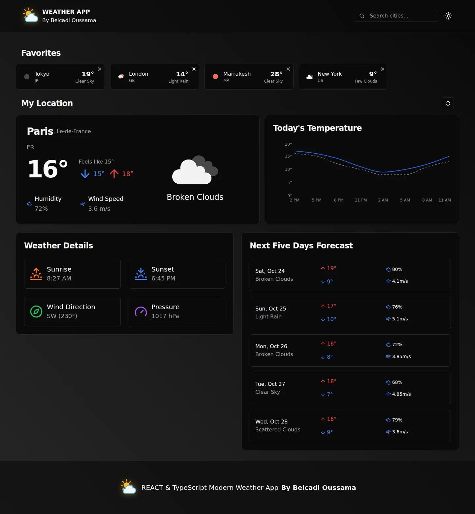
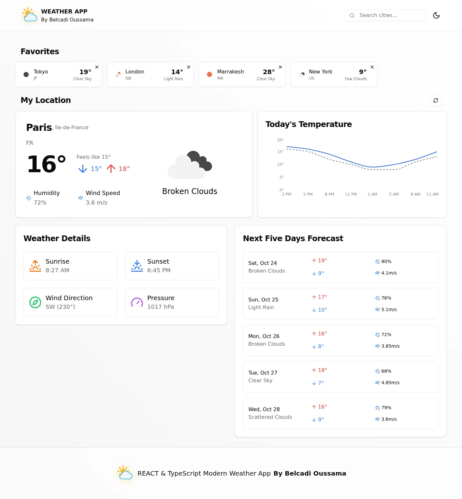
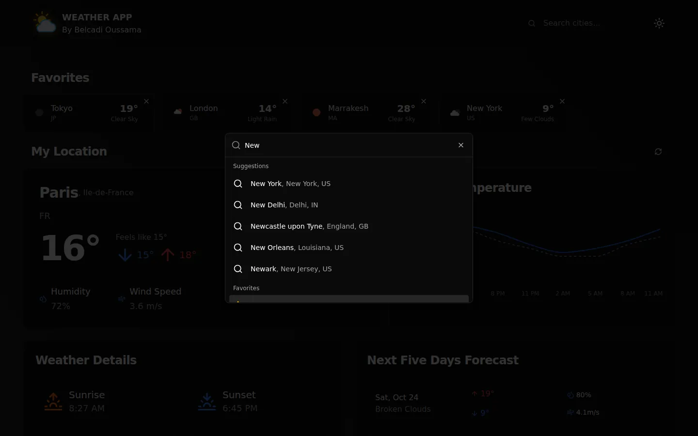
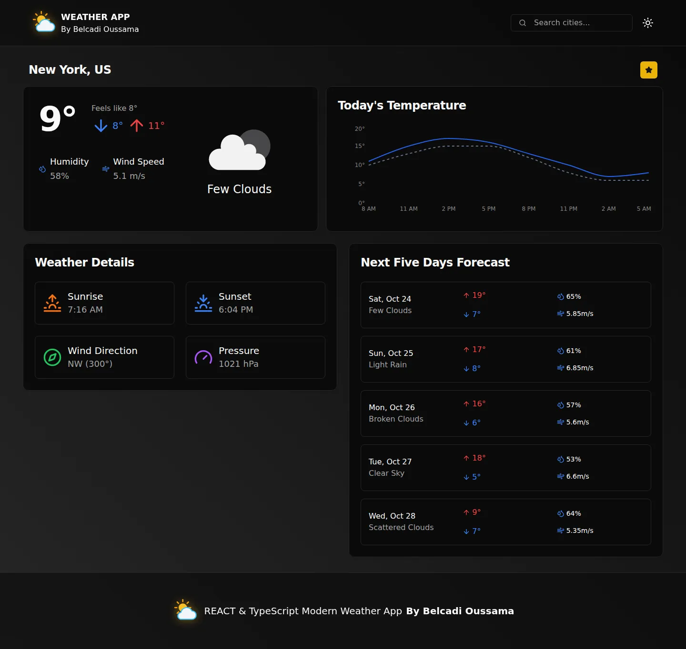
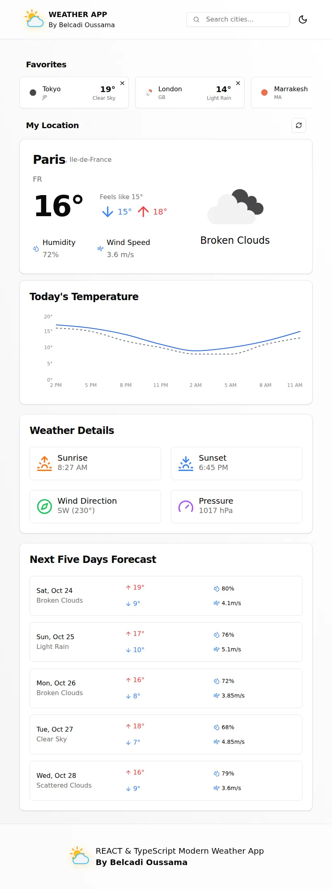
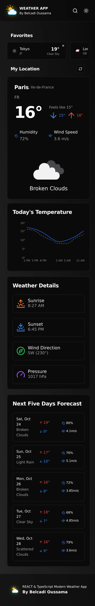
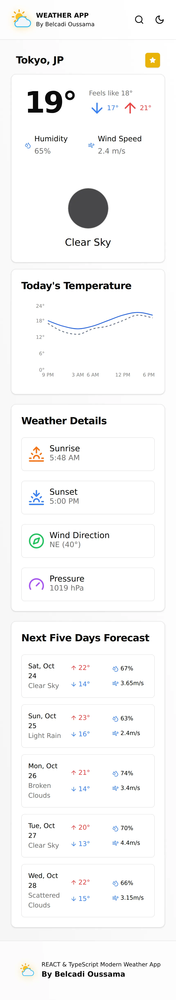

# Application météo : React, TypeScript et TanStack Query

[](https://github.com/blcoussama/REACT-TYPESCRIPT-TANSTACK-QUERY/actions/workflows/ci.yml)
[](LICENSE)

Application monopage qui affiche la météo de votre position ou de n'importe quelle ville
à partir de l'API OpenWeather, avec les données mises en cache par TanStack Query.
L'interface est en anglais.

## Captures

> **Données de démonstration.** Ce sont de vraies captures de l'application (build de
> production lancé en local), prises avec Playwright. Les requêtes vers OpenWeather ont été
> interceptées (`page.route`) et remplacées par des réponses JSON fictives : les températures
> affichées ne sont pas des mesures réelles.

| Tableau de bord (sombre) | Tableau de bord (clair) |
|---|---|
|  |  |

| Recherche de ville | Page d'une ville (New York) |
|---|---|
|  |  |

| Tablette | Mobile (sombre) | Mobile, page de Tokyo (clair) |
|---|---|---|
|  |  |  |

## Fonctionnalités

- **Météo de votre position** par géolocalisation du navigateur. Si elle est refusée ou
  indisponible, la météo de Londres s'affiche avec un message et un bouton « Use my location ».
- **Recherche de villes** (API de géocodage OpenWeather) : requête envoyée 350 ms après la
  dernière frappe, à partir de 3 caractères, avec indicateur de chargement ; historique des
  10 dernières recherches.
- **Page ville** : météo actuelle, courbe des températures sur 24 h (pas de 3 h), lever et
  coucher du soleil, vent, pression, prévisions des 5 jours suivants. **Les heures et les jours
  sont affichés dans le fuseau horaire de la ville**, quel que soit celui du navigateur.
- **Favoris** enregistrés dans le navigateur, avec la température actuelle de chaque ville.
- **Thème clair / sombre**, interface responsive (mobile, tablette, ordinateur).
- **Cache TanStack Query** : données fraîches pendant 5 min, conservées 10 min, pas de
  rechargement au retour sur l'onglet.
- **Erreurs explicites** : clé d'API absente (aucune requête n'est envoyée), clé refusée (401),
  quota dépassé (429), lien de ville sans coordonnées valides.

## Stack

| Domaine | Outils |
|---|---|
| Interface | React 18, TypeScript 5.6 (mode `strict`), React Router 7 |
| Données | TanStack Query 5, API OpenWeather (Current Weather, 5 day / 3 hour Forecast, Geocoding) |
| UI | Tailwind CSS 3, composants shadcn/ui (Radix UI, cmdk), lucide-react, Sonner |
| Graphique | Recharts 2 (chargé à la demande) |
| Outillage | Vite 6, ESLint 9, Vitest 5 + Testing Library, GitHub Actions |

## Architecture

```
src/
├── api/          # config.ts (endpoints HTTPS, ville de repli), weather.ts (client + erreurs), types.ts
├── hooks/        # requêtes TanStack Query, géolocalisation, favoris, historique, debounce
├── lib/          # time.ts (fuseau de la ville), forecast.ts, routes.ts (URL des villes), errors.ts
├── components/   # cartes météo, recherche, favoris, en-tête ; ui/ = composants shadcn
├── context/      # thème clair / sombre
└── routes/       # WeatherDashboard (accueil), CityPage (/city/:cityName?lat=&lon=)
```

Les favoris passent par une seule entrée du cache TanStack Query, enregistrée dans
`localStorage` : l'étoile de la page ville, la barre des favoris et la recherche lisent la même
liste. La page ville et le graphique Recharts sont chargés à la demande (`React.lazy`) : le
bundle initial passe de 784 kB à 402 kB (127 kB gzip).

## Installation et lancement

Prérequis : Node.js 24 (utilisé par la CI ; Node 22.22 ou plus récent fonctionne aussi,
Vitest et jsdom l'exigent) et une clé d'API OpenWeather gratuite.

1. Créer un compte sur [openweathermap.org](https://openweathermap.org/) et copier une clé
   depuis [la page des clés d'API](https://home.openweathermap.org/api_keys). Le plan gratuit
   suffit. Une clé neuve peut mettre un certain temps à être activée : en attendant, l'API
   répond 401 et l'application l'indique.
2. Installer et configurer :

   ```bash
   git clone https://github.com/blcoussama/REACT-TYPESCRIPT-TANSTACK-QUERY.git
   cd REACT-TYPESCRIPT-TANSTACK-QUERY
   npm ci
   ```

   Créer à la racine un fichier `.env.local` (ignoré par git) contenant :

   ```dotenv
   VITE_OPENWEATHER_API_KEY=votre_cle
   ```

3. Lancer : `npm run dev`, puis ouvrir http://localhost:5173. Après une modification du
   fichier `.env.local`, relancer le serveur.

Sans clé, l'application démarre quand même et affiche « API key required » avec la marche à
suivre, sans envoyer de requête à OpenWeather.

### Variables d'environnement

| Variable | Obligatoire | Rôle |
|---|---|---|
| `VITE_OPENWEATHER_API_KEY` | oui | Clé de l'API OpenWeather, lue par le navigateur au moment des requêtes. |

Toute variable préfixée `VITE_` est intégrée au JavaScript envoyé au navigateur : la clé est
donc visible par les visiteurs (voir [Limites connues](#limites-connues)).

### Scripts

| Commande | Rôle |
|---|---|
| `npm run dev` | Serveur de développement Vite |
| `npm run build` | Vérification TypeScript puis build de production dans `dist/` |
| `npm run preview` | Sert le build de production en local |
| `npm run lint` | ESLint |
| `npm run typecheck` | `tsc -b` (mode strict) |
| `npm test` | Tests Vitest (`npm run test:watch` en mode interactif) |

## Tests

41 tests Vitest (environnement jsdom), lancés par `npm test` et par la CI :

- **Client API** : endpoints en HTTPS, paramètres encodés, aucune requête sans clé (`fetch`
  n'est pas appelé), message dédié pour une clé refusée (401).
- **Fuseaux horaires** : heures et jours calculés dans le fuseau de la ville (décalages
  négatifs, positifs, Katmandou à +5 h 45), résultat identique quel que soit le fuseau du
  navigateur, regroupement des prévisions par jour local.
- **Routes** : nom de ville encodé dans l'URL, coordonnées absentes, invalides ou hors bornes.
- **Hooks** : favoris partagés entre deux composants, persistance, pas de doublon, stockage
  corrompu ignoré ; délai de recherche (debounce).

## Intégration continue

`.github/workflows/ci.yml`, à chaque push sur `main` et à chaque pull request, sans aucun
secret : `npm ci`, lint, vérification des types, tests, build, puis
`npm audit --omit=dev --audit-level=moderate`.

## Déploiement

L'application n'est pas déployée. C'est un site statique : Vercel ou Netlify conviennent.

1. Importer le dépôt (commande de build `npm run build`, dossier publié `dist`).
2. Déclarer `VITE_OPENWEATHER_API_KEY` dans les variables d'environnement de l'hébergeur,
   avec **une clé créée uniquement pour la démo** (elle sera publique dans le bundle), à
   régénérer en cas d'abus.
3. `vercel.json` et `netlify.toml` renvoient toutes les routes vers `index.html` : un lien
   direct ou un rechargement sur `/city/...` fonctionne.

## Sécurité et données personnelles

- La clé d'API n'a jamais été versionnée : elle est lue depuis `import.meta.env`, et
  `.gitignore` exclut `.env`, `.env.*` et `*.local`.
- Tous les appels à OpenWeather passent en HTTPS (le géocodage était en HTTP, ce qui le
  faisait bloquer comme contenu mixte sur un site en HTTPS).
- Pas de serveur ni de compte : favoris, historique et thème restent dans le `localStorage` du
  navigateur. La position n'est envoyée qu'à OpenWeather, pour obtenir la météo.
- Audit des dépendances : 0 vulnérabilité dans les dépendances de production
  (`npm audit --omit=dev`).

## Limites connues

- **Clé exposée côté client** : sans serveur intermédiaire, la clé est lisible dans le bundle.
  Un proxy (fonction serverless par exemple) serait nécessaire pour la cacher.
- **Outillage de développement** : `npm audit` signale encore 7 alertes (5 élevées,
  2 modérées) dans les dépendances de développement de Tailwind CSS 3 (`braces`,
  `postcss-selector-parser`). Elles ne concernent que le build, pas le code livré ; la
  correction passe par une migration vers Tailwind 4.
- « Today's Temperature » couvre les 24 prochaines heures, pas la journée calendaire. Dans les
  prévisions à 5 jours, l'humidité, le vent et la description viennent du premier créneau de
  3 h de chaque jour.
- Unités métriques uniquement ; interface en anglais.
- Pas de tests de bout en bout automatisés (les captures sont faites à la main avec Playwright).

## Origine du projet

Projet d'apprentissage réalisé en suivant un tutoriel YouTube (décembre 2024), parmi mes
premiers projets en React et TypeScript.

### Ce que j'ai ajouté / corrigé (octobre 2026)

- Géocodage en HTTPS ; message clair quand la clé d'API manque (avant : requêtes envoyées avec
  `appid=undefined`) ou est refusée.
- Heures et jours affichés dans le fuseau horaire de la ville (avant : celui du navigateur ;
  depuis le Maroc, New York affichait un lever du soleil à 13 h 20).
- Logo cassé sur les pages `/city/...` (chemin relatif) : nouveau logo météo servi en chemin
  absolu, aussi utilisé comme favicon.
- Nom de ville encodé dans l'URL ; page d'erreur si les coordonnées manquent (avant : météo
  du point 0, 0) ; ville de repli si la géolocalisation est refusée.
- Recherche avec délai et indicateur de chargement réellement visible ; libellés corrigés.
- Favoris gérés à un seul endroit (avant : chaque composant avait sa propre copie et la barre
  des favoris ne se mettait pas à jour).
- Accessibilité : vrais boutons et liens utilisables au clavier, `aria-label`, `aria-pressed`,
  un seul `<h1>` par page, titre accessible de la fenêtre de recherche.
- Nettoyage (`console.log`, fichiers et dépendances inutilisés), toasts alignés sur le thème.
- Dépendances : 19 vulnérabilités en production (16 élevées) → 0 ; 37 → 7 en comptant
  l'outillage de développement ; chargement différé de la page ville et de Recharts.
- Captures déplacées de `public/` (6,1 Mo copiés dans chaque build) vers `docs/screenshots/`
  au format WebP (environ 470 ko au total).
- Tests Vitest, CI GitHub Actions, configuration de déploiement, licence.

## Licence

[MIT](LICENSE) © 2024-2026 BELCADI Oussama
